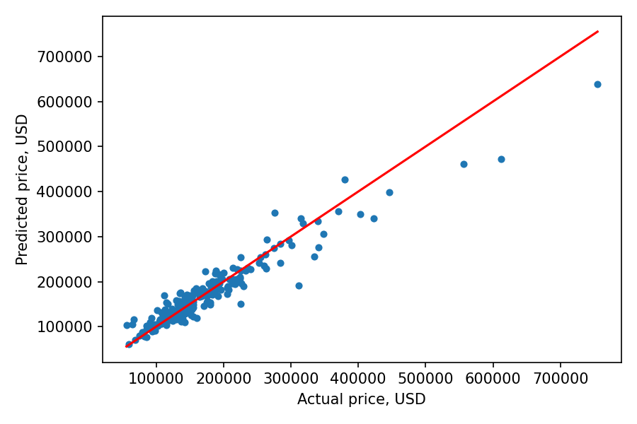
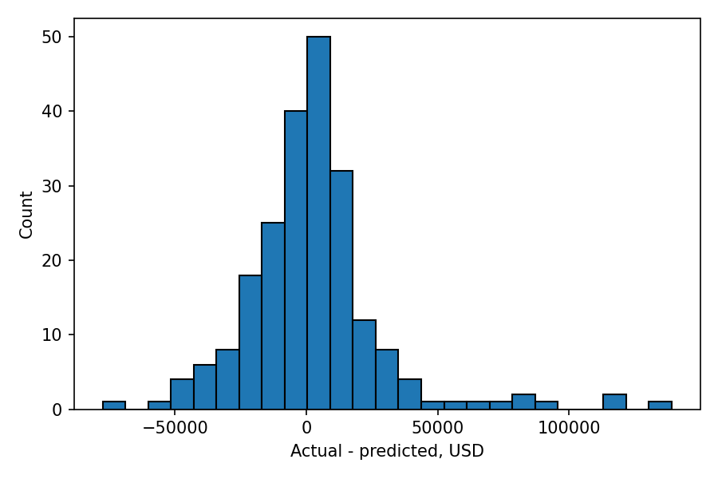
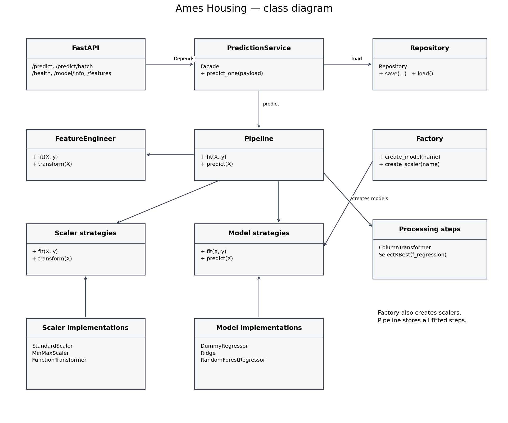

# Лабораторна робота № 6

Побудова моделі регресії для Ames Housing та розгортання вебсервісу

## 1 Мета та дані

Мета роботи — навчити просту модель прогнозування ціни будинку, порівняти кілька варіантів обробки даних і надати доступ до прогнозу через FastAPI. Для структури програми використано Strategy, Factory, Facade та Repository. Реалізація виконана на Python 3.12, без підбору гіперпараметрів і крос-валідації.

Використано набір house_prices з OpenML, data_id=42165. Він містить 1460 будинків. Із нього взято 12 вхідних ознак: OverallQual, GrLivArea, FirstFlrSF, TotalBsmtSF, GarageCars, YearBuilt, YrSold, FullBath, TotRmsAbvGrd, Neighborhood, KitchenQual і CentralAir. Цільова змінна — SalePrice у доларах США. Поле 1stFlrSF перейменовано на FirstFlrSF; Id та решта зайвих стовпців не подаються моделі.

Дані розділено двома викликами train_test_split із random_state=42: 1022 рядки для train, 219 для validation та 219 для test. Розбиття відтворюється функцією load_data. Модель обирається за найменшим MAE на validation. Підсумкова тестова оцінка обчислюється тільки для обраного варіанта. Аналіз у 01_eda.ipynb виконано лише на train.

### Спостереження та прийняті рішення

| Спостереження на train | Прийняте рішення |
|---|---|
| У вибраних 12 ознаках пропусків немає. | Обробку пропусків усе одно реалізовано для нових даних та перевірено окремими тестами. |
| Середня ціна 181312,69 USD, медіана 165000 USD. | Як базову модель використано прогноз медіаною; середня ціна зміщується через дорогі будинки. |
| Ціни лежать між 34900 і 745000 USD. | Великі значення автоматично не видаляються; для оцінки великих помилок разом із MAE використовується RMSE. |
| Кореляція OverallQual із ціною 0,785, GrLivArea — 0,689. | Якість і житлова площа залишаються серед вхідних ознак. |
| Neighborhood має 25 категорій. | Використано One-Hot та об'єднання категорій з частотою менше 1% у Other. |
| MeadowV, Veenker, NPkVill і Blueste мають 10, 8, 6 та 1 спостереження. | Ці чотири райони об'єднано в одну групу, щоб не створювати окремі малонаповнені стовпці. |
| Площа вимірюється тисячами, а кількість ванних — одиницями. | Для Ridge порівняно standard та minmax; для RandomForest обрано none. |

Гістограма цін збережена у saleprice_train.png. Розподіл має довгий правий хвіст, тому однаковий MAE може приховувати окремі значні помилки. Графіки та числові результати аналізу збережені разом із ноутбуком.

<div style="page-break-after: always;"></div>

## 2 Обробка та порівняння варіантів

Повний конвеєр складається з FeatureEngineer, ColumnTransformer, SelectKBest, стратегії масштабування та моделі. Один виклик fit навчає всі його кроки. На validation, test і в API використовується тільки predict, без повторного обчислення статистик.

FeatureEngineer запам'ятовує медіани числових ознак train та список достатньо поширених районів. Пропуски TotalBsmtSF і GarageCars замінюються нулем, інші числові пропуски — збереженими медіанами. Після заповнення обчислюються TotalSF = TotalBsmtSF + FirstFlrSF та HouseAge = YrSold - YearBuilt. Такий порядок дозволяє правильно врахувати відсутній підвал у загальній площі. За вимкнених нових ознак заповнення пропусків продовжує працювати.

Категоріальні пропуски заповнюються найчастішим значенням train. Далі OneHotEncoder перетворює категорії на нулі та одиниці. handle_unknown="ignore" не дозволяє невідомим категоріям зламати прогноз. Рідкісні та нові значення Neighborhood переводяться в Other. KitchenQual і CentralAir додатково перевіряються схемою API.

Після додавання двох ознак і кодування утворилося 39 стовпців. SelectKBest(f_regression) порівняно у двох режимах: усі стовпці та 15 найсильніше пов'язаних із ціною. Відбір навчається тільки на train та зберігається в конвеєрі.

### Порівняння Ridge на validation

У всіх варіантах alpha=10.0. MAE наведено в USD; «нові» означає TotalSF та HouseAge.

| Масштабування | Нові ознаки | Відбір | MAE | R² |
|---|---|---|---|---|
| standard | ні | усі | 19638,94 | 0,8792 |
| standard | ні | 15 | 20224,52 | 0,8766 |
| minmax | ні | усі | 21541,16 | 0,8554 |
| minmax | ні | 15 | 22399,43 | 0,8454 |
| standard | так | усі | 19636,72 | 0,8792 |
| standard | так | 15 | 20063,18 | 0,8768 |
| minmax | так | усі | 21259,87 | 0,8569 |
| minmax | так | 15 | 22109,44 | 0,8478 |

StandardScaler дав кращий MAE, ніж MinMaxScaler. Додавання нових ознак у standard з усіма стовпцями зменшило MAE лише на 2,22 USD, тобто практично не змінило результат. Це очікувано: обидві нові ознаки є лінійними комбінаціями вже наявних. За minmax з усіма стовпцями покращення становило 281,29 USD; масштабування змінює дію регуляризації.

Відбір 15 ознак не покращив найкращий варіант Ridge. Тому фінально збережено всі 39 стовпців. Деревам масштабування не потрібне, бо вони використовують пороги, а не зважену суму всіх ознак.

<div style="page-break-after: always;"></div>

## 3 Моделі та оцінка якості

Навчено DummyRegressor(strategy="median"), Ridge(alpha=10.0) та RandomForestRegressor(n_estimators=200, random_state=42). Для лісу використано один обчислювальний потік. Експерименти відтворюються конфігурацією та фіксованим розбиттям.

Нижче наведено найкращий перевірений варіант кожної моделі на validation. Для Ridge це standard з новими ознаками й усіма стовпцями, для RandomForest — none з новими ознаками й усіма стовпцями.

| Модель | MAE train | RMSE train | R² train | MAE val | RMSE val | R² val |
|---|---|---|---|---|---|---|
| Dummy | 54911,54 | 79275,97 | -0,0442 | 58741,92 | 81912,06 | -0,0682 |
| Ridge | 21108,96 | 33838,70 | 0,8097 | 19636,72 | 27547,69 | 0,8792 |
| RandomForest | 7352,80 | 12641,48 | 0,9734 | 16721,86 | 24835,42 | 0,9018 |

MAE показує середню абсолютну помилку, RMSE сильніше реагує на великі відхилення. Обидва вимірюються в USD. R² є безрозмірним показником. Від'ємний R² базового прогнозу медіаною можливий, бо R² порівнює результат із прогнозом середнім значенням.

За validation обрано RandomForest. Його MAE нижчий за Dummy на 42020,06 USD. R² дорівнює 0,9018, що перевищує орієнтир 0,70. На train похибка значно менша, ніж на validation: ознаки перенавчання є. Водночас validation показує корисний прогноз, тому модель залишено; обмеження глибини не підбиралося додатковими пошуками. За потреби глибина дерев обмежується параметром max_depth у конфігурації.

Для обраного варіанта на test отримано MAE 17266,87 USD, RMSE 26899,55 USD, R² 0,9049. Після цієї оцінки модель не перенавчалася й не замінювалася за результатом test. Тестові показники наведено як підсумок, а не як підставу вибору моделі.





Більшість прогнозів лежить близько до діагоналі. Для частини найдорожчих будинків ціна занижується. Більшість залишків знаходиться біля нуля, але є великі позитивні залишки, які збільшують RMSE.

<div style="page-break-after: always;"></div>
## 4 Патерни проєктування

### Strategy

Модель і масштабування передаються в Pipeline як взаємозамінні об'єкти. Моделі мають спільні fit та predict, а засоби масштабування — fit та transform. Використано готові реалізації scikit-learn: DummyRegressor, Ridge, RandomForestRegressor, StandardScaler, MinMaxScaler та FunctionTransformer. Останній залишає дані без масштабування.

Новий алгоритм має підтримувати такий самий інтерфейс. Окремі обгортки навколо кожного готового класу не створювалися: вони лише повторювали б його методи.

### Factory

Factory містить два словники: models і scalers. Методи create_model та create_scaler створюють потрібний об'єкт за назвою. Назви обираються конфігурацією, тому для нової реалізації достатньо додати клас у словник і його ім'я в YAML.

Додавання нового масштабування можна перевірити без зміни класів і коду навчання:

```python
from sklearn.preprocessing import RobustScaler
from core import Factory

class RobustScaling(RobustScaler):
    pass

Factory.scalers["robust"] = RobustScaling
```

Після реєстрації make_pipeline("ridge", "robust") використовує нову стратегію. Для навчання її через загальний сценарій у configs/config.yaml слід вказати robust у scalers і імпортувати новий модуль перед запуском run. Це демонструє розширення через новий клас і реєстрацію, без змін існуючих реалізацій.

### Facade

PredictionService приховує роботу з таблицею та збереженим конвеєром. Метод predict_one приймає словник із 12 полями й повертає ціну. Обробники API не викликають pandas чи методи навчання. Для іншого клієнта достатньо використати цей самий сервіс.

### Repository

Repository зосереджує save та load. Він зберігає model.joblib, feature_schema.json і metadata.json. Разом із моделлю зберігається вся обробка, а в метаданих — версія, дата, показники та версії бібліотек. Для зміни сховища потрібен інший клас із такими самими методами.

П'ять прогнозів validation перед збереженням записано в docs/reload.json. Тест у новому процесі завантажив модель і підтвердив ті самі прогнози з точністю до центів.
<div style="page-break-after: always;"></div>
## 5 Структура програми



Програма складається з чотирьох Python-файлів. core.py містить читання даних, обробку, фабрику, репозиторій і сервіс прогнозування. train.py порівнює варіанти та зберігає найкращу модель. app.py описує схеми запитів і п'ять маршрутів FastAPI. test_app.py перевіряє їхню роботу та повторне завантаження моделі.

У configs/config.yaml зберігаються назви алгоритмів, random_state, параметри моделей та поріг рідкісних категорій. CSV уже додано до проєкту. Повторне навчання виконується без інтернету.

FastAPI отримує PredictionService через Depends. Після першого успішного завантаження сервіс кешується функцією load_service. Повторні запити не читають артефакти з диска.
<div style="page-break-after: always;"></div>

## 6 API та перевірка роботи

| Метод | Шлях | Призначення |
|---|---|---|
| GET | /health | Стан і ознака завантаженої моделі |
| GET | /model/info | Версія, параметри та показники |
| GET | /features | Порядок полів і категорії |
| POST | /predict | Прогноз одного будинку |
| POST | /predict/batch | Від 1 до 100 будинків |

House описує 12 обов'язкових полів. Площі та кількості перевіряються на невід'ємність; житлова площа має бути додатною. OverallQual обмежено від 1 до 10. Роки обмежено умовою; рік побудови не може бути пізнішим за рік продажу. KitchenQual і CentralAir мають фіксовані значення. Новий Neighborhood допускається. Відповідь містить prediction, currency та model_version.

Приклад запиту POST /predict:

```json
{
  "OverallQual": 7, "GrLivArea": 1710, "FirstFlrSF": 856,
  "TotalBsmtSF": 856, "GarageCars": 2, "YearBuilt": 2003,
  "YrSold": 2008, "FullBath": 2, "TotRmsAbvGrd": 8,
  "Neighborhood": "CollgCr", "KitchenQual": "Gd", "CentralAir": "Y"
}
```

Відповідь перевіреного сервера:

```json
{"prediction": 201091.5, "currency": "USD", "model_version": "v1"}
```

Виконано 8 тестів pytest: успішний прогноз, відсутнє поле, від'ємна площа, однакові результати повторних запитів, невідомий район, пакетний режим та його ліміт, код 503 за відсутності моделі й повторне завантаження п'яти прогнозів. Результат: 8 passed. Неправильні вхідні дані повертають код 422.

Додатково перевірено інформаційні маршрути та документацію /docs. Значення MAE, RMSE та R² після спрощення залишилися такими самими, бо алгоритми та розбиття даних не змінювалися.

### Обмеження та висновок

Модель навчена на продажах в Ames за 2006–2010 роки. Її не можна вважати оцінкою сучасної вартості будинку в іншій країні чи місті. Використано лише 12 ознак, найдорожчі будинки представлені слабо. Сервіс не оцінює інтервал невизначеності. Перевірка API вимагає обов'язкових полів, хоча конвеєр уміє обробляти пропуски під час навчання й внутрішнього використання.

У роботі отримано модель, кращу за базову, збережено повний конвеєр і реалізовано API. Патерни дозволяють окремо змінювати алгоритми, створення об'єктів, спосіб доступу до прогнозу та зберігання артефактів.

Джерела: https://www.openml.org/d/42165 ; https://scikit-learn.org/stable/ ; https://fastapi.tiangolo.com/ .
